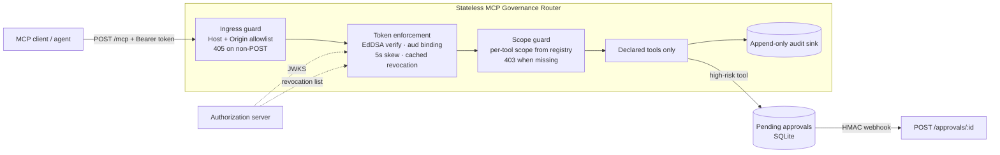

# Stateless MCP Governance Router

A Model Context Protocol (MCP) server that exposes a small, curated set of tools to agents over stateless
HTTP — with authentication, per-tool authorization, containment and an audit trail wrapped around every
call.

The point of the project is the governance layer, not the tools. Any MCP server can list tools; this one
decides *who* may call *what*, refuses everything it does not know about, and records the decisions.

---

## Why this exists

Giving an agent tool access is easy. Giving it tool access you can defend in production is not:

- A tool server with no authentication is remote capability execution for anyone who can reach the port.
- A server that keeps session state cannot be scaled horizontally, and a long-lived stream pins a caller to
  one replica.
- A tool that accepts free-form input (`dict`, `Any`) is an injection surface.
- A tool that can read any path or call any host bypasses every earlier control.
- Tools with real side effects (deleting data, sending mail) should not run on a model's decision alone.
- Without an audit trail you cannot answer "who called what, and was it allowed?" after an incident.

Each of those concerns is a layer in this repo.

---

## Architecture



The router is stateless: no session state is kept between requests, so any replica can serve any call. The
token *is* the session.

---

## Request flow

1. **Ingress guard** — checks `Host` (and `Origin` when present) against allowlists. Anything else is `400
   HeaderMismatch`. Non-POST on `/mcp` is `405` with `Allow: POST`.
2. **Token enforcement** — validates the bearer token locally: signature against the cached JWKS, `iss`, hard
   `aud` binding, `exp`/`nbf` with a 5-second clock-skew tolerance, then a cached revocation lookup.
   Failures return `401` with a `WWW-Authenticate` hint and a stable error code.
3. **Scope guard** — reads the requested tool from the JSON-RPC body and checks the token's scope against the
   registry. A valid token without the tool's scope gets `403 insufficient_scope` and tool code never runs.
4. **Tool dispatch** — only tools declared in the registry can be listed or invoked. Tools needing human
   sign-off return `approval_required` with a durable request id instead of executing.
5. **Audit** — every decision above is appended to a JSONL audit sink.

---

## Tools

| Tool | Namespace | Scope | Tier | Approval |
|------|-----------|-------|------|----------|
| `documents.read_document` | documents | `mcp:documents:read` | core | no |
| `reports.summarize_documents` | reports | `mcp:reports:read` | extended | no |
| `reports.ask_model` | reports | `mcp:reports:read` | extended | no |
| `files.read_text` | files | `mcp:files:read` | extended | no |
| `documents.purge_document` | documents | `mcp:documents:write` | extended | **yes** |

`tools/list` is scope-driven: a caller only sees the tools its token can actually use. Extended tools also
require an explicit discovery scope (`mcp:tools:extended`), so a default token sees the minimal set.

---

## Security properties

- **OAuth 2.1 authorization server** with `private_key_jwt` client assertions (RFC 7523, Ed25519). No shared
  client secrets, no Dynamic Client Registration.
- **Audience-bound, short-lived tokens** (≤15 min) with per-namespace scopes.
- **Rate limiting on the token endpoint**: a per-client bucket returns `429` with `Retry-After` instead of
  letting one client exhaust the issuer.
- **Replay protection that can be shared**: assertion `jti`s are stored in-process by default, or in Redis
  (`REDIS_URL`) so the limit still holds with several authorization-server replicas.
- **Local validation** in the resource server: JWKS is cached, revocation is served from cache — a request
  never blocks on the authorization server.
- **Clock-skew tolerance is explicit**: 5 seconds, applied at validation, asserted in tests.
- **Containment**: file paths are canonicalised (`realpath`) before being checked against configured roots, so
  traversal and symlink escapes are rejected. Outbound calls are deny-by-default against an allowlist and
  private/loopback/link-local/metadata ranges are blocked.
- **Human-in-the-loop for destructive tools**: an HMAC-signed, timestamped, single-use webhook must approve the
  exact request before it executes. Replays are rejected (`409`).
- **Append-only audit sink**; a failed audit write is reported rather than swallowed.

---

## Quickstart

```bash
python -m venv .venv && source .venv/bin/activate
pip install -e ".[dev]"

cp .env.example .env
python scripts/bootstrap_dev.py          # generates the AS key + a registered dev client

# terminal 1 — authorization server
python -m mcp_router.authorization_server

# terminal 2 — the governed MCP router
python -m mcp_router.server
```

Fetching a token requires a signed client assertion, so the client code is easier to read than to curl:
`signed_assertion()` and `token_request()` in `tests/test_authorization_server.py` show the full exchange,
and `scripts/e2e_harness.py` runs the whole governed flow end to end.

Calling a tool (once you hold a token):

```bash
curl -s http://127.0.0.1:8000/mcp \
  -H "Authorization: Bearer $TOKEN" \
  -H "Accept: application/json, text/event-stream" \
  -H "Content-Type: application/json" \
  -d '{"jsonrpc":"2.0","id":1,"method":"tools/call",
       "params":{"name":"documents.read_document",
                 "arguments":{"request":{"tenant_id":"tenant-a","document_id":"doc-001"}}}}'
```

---

## Verification

```bash
pytest -q                     # 71 tests: auth server, enforcement, ingress, registry, containment, approvals, hardening
python scripts/e2e_harness.py  # 12 governance checks against a real app instance
python scripts/benchmark_tokens.py
python scripts/load_test.py    # against a running instance (default :8010)
```

Current results on this machine:

- `pytest`: **71 passed**
- `scripts/e2e_harness.py`: **12/12 checks passed** — token required, cross-scope 403, host mismatch 400,
  GET 405, authorized read 200, path escape denied, approval required → signed approval → executes once →
  replay rejected → single-use confirmed.
- `scripts/benchmark_tokens.py`: discovery payload drops from **880 bytes** (full exposure) to **172 bytes**
  (scope-filtered progressive disclosure), a **80.5% reduction**; p50 of local serialisation is 0.004 ms vs
  0.001 ms over 100 iterations.

---

## Implemented / verified / gaps

| Area | Implemented | Verified |
|------|-------------|----------|
| Authorization server (metadata, JWKS, `/token`, `/revoke`, `/revoked`) | yes | yes — 10 tests |
| private_key_jwt validation (signature, iss/sub, aud, exp, jti replay) | yes | yes — happy path + 5 negatives |
| Token enforcement (401 paths, skew, cached revocation) | yes | yes — 12 tests, incl. "no per-request fetch" |
| Ingress guard (Host/Origin, 405) | yes | yes — 8 tests |
| Registry (strict contracts, namespaces, scopes, tiers) | yes | yes — 14 tests |
| Scope guard (403, cross-namespace) | yes | yes — harness + tests |
| Progressive disclosure | yes | yes — listing assertions + benchmark |
| Path containment + egress policy | yes | yes — 8 tests |
| Audit sink | yes | yes — event assertions + write-failure test |
| Approval webhook (HMAC, single-use) | yes | yes — 6 tests + harness |
| Token-endpoint rate limiting (429 + Retry-After) | yes | yes — endpoint test |
| Shared replay store (Redis `SET NX EX`) | yes | yes — verified against a live Redis container |
| Docker image | yes | yes — built and exercised (401 / 405 / 400 from the container) |
| Deployment (AWS ECS Fargate) | **no** | — |

**Not deployed.** This project is verified locally and is not running in any hosted environment. A
`Dockerfile` and a GitHub Actions workflow are included; the workflow has not been run on GitHub yet.

---

## Layout

```
src/mcp_router/
  authorization_server.py   OAuth 2.1 AS: metadata, JWKS, /token, /revoke
  tokens.py                 claim model, mint/verify, private_key_jwt assertion checks
  keys.py clients.py        Ed25519 key handling, registered clients
  jwks_cache.py             cached key set with rotation refresh
  revocation_cache.py       cached revocation list
  ingress_guard.py          Host/Origin allowlist, 405
  enforcement.py            bearer token validation middleware
  scope_guard.py            per-tool scope enforcement (403)
  disclosure.py             scope-driven tools/list
  registry.py               tool declarations + strict contract validation
  containment.py            realpath root confinement, egress policy
  audit.py                  append-only JSONL audit sink
  approvals.py              pending-approval store + HMAC webhook verification
  server.py                 wiring: registry, middleware chain, routes
docs/owasp-mcp-mapping.md   OWASP MCP Top-10 control mapping + known gaps
scripts/                    bootstrap, e2e harness, token benchmark
tests/                      pytest suite
```

---

## Operational verification

Run on this machine, against a real container and a real Redis:

- **Image builds and serves:** `docker build -t mcp-governance-router:local .` → rebuilt cleanly; the container
  answers `401` without a token, `405` + `Allow: POST` on GET, and `400 HeaderMismatch` on a foreign Host.
- **Redis replay store:** verified against a live Redis 7 container — a second store instance rejects the same
  `jti`, which is the multi-replica claim (`tests/test_redis_live.py`, 3 tests, skipped when no Redis is present).
- **Load:** 300 requests at concurrency 25 through the governance chain (unauthenticated path) →
  **612 req/s, p50 29 ms, p95 97 ms, p99 141 ms, 0 errors**, every request correctly `401`.
- **Dependency audit:** `pip-audit` → **no known vulnerabilities** in both the development environment and the
  runtime image.

---

## Roadmap

- Redis-backed replay store and rate limiting on the token endpoint.
- Deployment (planned: AWS ECS Fargate) — not started.
- Promote the in-memory document store to PostgreSQL with row-level security.
